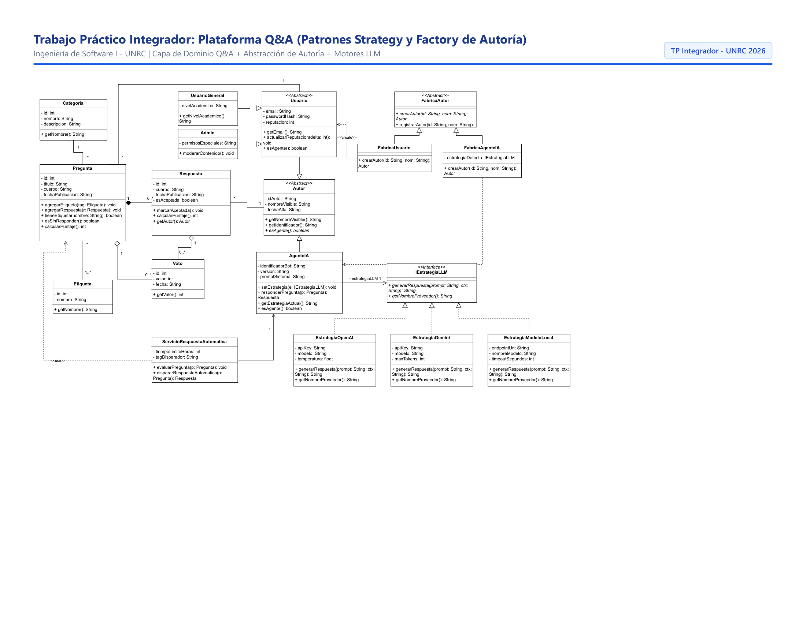

# Trabajo Práctico: Diseño de Modelo Conceptual (UML)
## Plataforma Colaborativa de Preguntas y Respuestas (Q&A)

> **Materia:** Ingeniería de Software I (3385) — Universidad Nacional de Río Cuarto (UNRC)  
> **Tema:** Modelo de Clases Conceptual, Polimorfismo, Patrón Strategy y Factory Method de Autoría.  
> **Entrega:** Diagrama UML y Justificación de Patrones de Diseño.

---

## 1. Introducción y Enfoque del Diseño

En el presente trabajo práctico desarrollamos el diseño del **modelo de clases conceptual (UML)** para una **Plataforma Colaborativa de Preguntas y Respuestas (Q&A)** orientada a estudiantes universitarios.

Al analizar las características funcionales y los puntos de variación requeridos, decidimos organizar nuestra propuesta en **dos capas conceptuales bien delimitadas**:

1. **Capa del Dominio de Negocio (Core Q&A):** Modela las entidades centrales de la plataforma comunitaria (`Pregunta`, `Respuesta`, `Categoria`, `Etiqueta` y `Voto`), asegurando las restricciones funcionales de asociación y multiplicidad.
2. **Capa de Patrones y Extensibilidad (Diseño GoF):** Resuelve de manera flexible y extensible dos desafíos fundamentales de la arquitectura:
   - La **abstracción de autoría**, permitiendo atribuir respuestas homogéneamente tanto a usuarios humanos como a agentes de inteligencia artificial.
   - El **motor de generación automática de respuestas**, desacoplando la lógica de la plataforma de los diferentes proveedores de Modelos de Lenguaje Grande (LLMs) mediante el patrón **Strategy**.

---

## 2. Diagrama de Clases Conceptual (UML)

A continuación incluimos la representación visual completa de nuestro modelo. También dejamos disponibles en esta carpeta el archivo vectorial [**`modeladoUml - TP.pdf`**](./modeladoUml%20-%20TP.pdf) y el archivo editable [**`modeladoUml - TP.drawio`**](./modeladoUml%20-%20TP.drawio) para su apertura en diagrams.net.



---

## 3. Justificación de Decisiones de Diseño y Patrones Seleccionados

### 3.1. Abstracción y Creación de Autoría: Polimorfismo y Factory Method

#### El Problema que Identificamos
En un diseño inicial simple, la tentación habitual es relacionar directamente cada `Respuesta` con un `Usuario` humano mediante una referencia directa (`usuario_id`). Sin embargo, el enunciado exige que **las respuestas puedan ser elaboradas tanto por usuarios registrados como por un agente de respuesta automática asistido por IA**.

Si hubiésemos relacionado `Respuesta` con `Usuario` y con `AgenteIA` mediante asociaciones separadas, habríamos introducido:
- Atributos o claves foráneas opcionales (posibles valores nulos en la base de datos).
- Comprobaciones condicionales repetitivas (`if (r.esDeUsuario()) ... else if (r.esDeIA()) ...`) dispersas por toda la aplicación, violando los principios de la Programación Orientada a Objetos.

#### Nuestra Solución Polimórfica
Para resolver esta rigidez, decidimos introducir la **superclase abstracta `Autor`**:
1. **Contrato Común:** `Autor` define la interfaz y comportamiento base compartido por cualquier emisor de contenido (`idAutor`, `nombreVisible`, `getIdentificador()`, `esAgente()`).
2. **Desacoplamiento en `Respuesta`:** La clase `Respuesta` se vincula exclusivamente con la abstracción (`Respuesta "*" --> "1" Autor`). De este modo, a la respuesta no le concierne si quien la redactó fue un estudiante autenticado o un bot; simplemente delega las consultas polimórficamente a su autor.
3. **Especialización Humana (`Usuario`):** Agrupa la lógica de autenticación (email, contraseña cifrada) y reputación de la comunidad, permitiendo a su vez subclasificar roles como `UsuarioGeneral` y `Admin`.
4. **Especialización de IA (`AgenteIA`):** Modela el bot inteligente como un autor de pleno derecho, dotado de un prompt de sistema, una versión y su motor de inferencia.

#### Aplicación del Patrón Creacional Factory Method
Para desacoplar la creación de instancias de autor del resto de la plataforma, implementamos el patrón **Factory Method**:
- **`FabricaAutor` (Abstract Creator):** Define la operación de fabricación abstracta `crearAutor(id, nombre): Autor` y centraliza la lógica común de registro en el sistema.
- **`FabricaUsuario` (Concrete Creator):** Encapsula la instanciación de usuarios humanos.
- **`FabricaAgenteIA` (Concrete Creator):** Encapsula la creación del agente de IA, permitiendo además inyectar la estrategia LLM correspondiente de manera transparente sin exponer esa complejidad a los controladores o capas superiores.

---

### 3.2. Generación de Respuestas con LLM: Patrón Strategy

#### El Problema que Identificamos
El sistema debe conectarse a modelos de inteligencia artificial para generar respuestas automáticas. En la práctica, existen múltiples proveedores con características, precios, latencias y protocolos muy disímiles:
- APIs comerciales en la nube: OpenAI (`GPT-4o`), Google (`Gemini 1.5 Pro`).
- Modelos locales autoalojados en servidores propios: Ollama o vLLM (`Llama-3-8B`, `Mistral`), esenciales para garantizar privacidad y reducir costos en el ámbito universitario.

Si hubiésemos codificado las llamadas a una API específica directamente dentro de la clase `AgenteIA`, el sistema habría quedado rígidamente acoplado a ese proveedor. Cualquier cambio de biblioteca, caída de servicio o migración de proveedor requeriría modificar el código central del dominio, violando el **Principio Abierto/Cerrado (OCP)** y el **Principio de Responsabilidad Única (SRP)**.

#### Nuestra Solución mediante el Patrón Strategy
Elegimos implementar el patrón de comportamiento **Strategy** porque permite encapsular una familia de algoritmos (en este caso, la comunicación con cada LLM) y hacerlos intercambiables:

1. **Contexto (`AgenteIA`):** Mantiene una referencia a la interfaz `IEstrategiaLLM`. Cuando el agente debe responder una pregunta, arma el prompt contextual con el título y cuerpo de la pregunta y delega la ejecución:
   $$\text{contenido} = \text{this.estrategiaLLM.generarRespuesta(prompt, contexto)}$$
   Permite además cambiar la estrategia dinámicamente en tiempo de ejecución mediante `setEstrategia(e)`.
2. **Interfaz de Estrategia (`IEstrategiaLLM`):** Declara el contrato uniforme:
   ```java
   public String generarRespuesta(String prompt, String contexto);
   public String getNombreProveedor();
   ```
3. **Estrategias Concretas:**
   - `EstrategiaOpenAI`: Encapsula la comunicación con la API de OpenAI, gestionando headers de autenticación, modelo y temperatura.
   - `EstrategiaGemini`: Implementa la conexión con la API de Google Gemini (manejo de safety settings y tokens de salida).
   - `EstrategiaModeloLocal`: Implementa la llamada HTTP REST contra una instancia local de Ollama/vLLM sin costo y con total privacidad de datos.

#### Beneficios Concretos que Obtenemos
- **Extensibilidad sin Modificación (OCP):** Si el día de mañana deseamos incorporar un nuevo proveedor (por ejemplo, Claude de Anthropic o DeepSeek), simplemente programamos una nueva clase `EstrategiaClaude` que implemente `IEstrategiaLLM`. No es necesario tocar ni una sola línea de código existente en `AgenteIA`, `Pregunta` o `Respuesta`.
- **Intercambiabilidad en Caliente (Runtime Switching):** Si la cuota de la API de OpenAI se agota o se pierde la conexión a internet externa, el sistema puede conmutar en tiempo de ejecución hacia `EstrategiaModeloLocal` o `EstrategiaGemini`.
- **Facilidad de Pruebas Automatizadas (Testabilidad):** Para los tests unitarios con `pytest`, podemos inyectar una estrategia simulada (`EstrategiaMockLLM`) que retorne respuestas predefinidas al instante, sin gastar saldo ni requerir conexión a internet.

---

### 3.3. Orquestación del Agente Automático (`ServicioRespuestaAutomatica`)

Para cumplir con el requerimiento de responder automáticamente ante:
1. Preguntas que incluyan una etiqueta disparadora (por ejemplo, `#ia-help`), o
2. Preguntas que permanezcan sin responder durante un tiempo límite determinado,

decidimos no sobrecargar la entidad `Pregunta` con responsabilidades de ejecución ni procesos en segundo plano. En su lugar, diseñamos la clase de servicio del dominio **`ServicioRespuestaAutomatica`**:
- Posee los atributos de configuración `- tiempoLimiteHoras: int` y `- tagDisparador: String`.
- El método `evaluarPregunta(p: Pregunta)` es invocado cuando se publica una nueva pregunta o periódicamente mediante una tarea programada (*background task* / cron).
- Si la pregunta cumple con las condiciones (`p.tieneEtiqueta("#ia-help")` o `p.esSinResponder()`), el servicio solicita a `agenteIA.responderPregunta(p)` y asocia automáticamente la nueva respuesta a la pregunta.

---

## 4. Entregables Disponibles en este Repositorio

En este directorio dejamos a disposición todos los artefactos que conforman nuestra entrega:

| Archivo | Formato | Descripción |
| :--- | :--- | :--- |
| [**`README.md`**](./README.md) | Markdown | Este informe técnico completo con diagrama visual y justificaciones de diseño. |
| [**`diagrama_modelo_conceptual.png`**](./diagrama_modelo_conceptual.png) | Imagen PNG | Renderizado en alta resolución (200 DPI) para visualización directa en GitHub. |
| [**`modeladoUml - TP.pdf`**](./modeladoUml%20-%20TP.pdf) | Documento PDF | Diagrama exportado en formato vectorial listo para imprimir o enviar. |
| [**`modeladoUml - TP.drawio`**](./modeladoUml%20-%20TP.drawio) | XML Draw.io | Archivo nativo editable directamente en diagramas.net / Draw.io. |

---

## 5. Conclusión

Consideramos que el modelo propuesto responde con precisión a todos los requerimientos funcionales y no funcionales planteados en la consigna. La aplicación combinada de **Polimorfismo / Factory Method** para la autoría y el patrón **Strategy** para la integración de LLMs garantiza una arquitectura desacoplada, testeable y preparada para evolucionar hacia la etapa de implementación.
